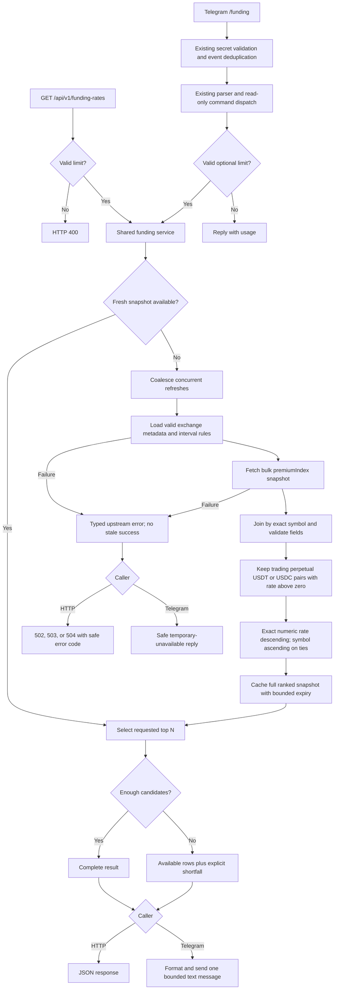
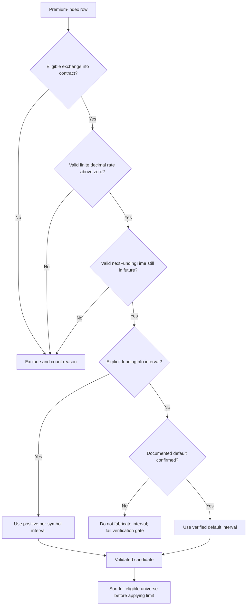

# Positive Funding Rates — Detailed Implementation Plan

Status: planned; no application changes implemented.
Source specification: `docs/funding-rate.md`.
Planning date: 2026-10-14.

## 1. Objective and scope

Expose Binance USDⓈ-M perpetual futures with positive funding rates through:

- `GET /api/v1/funding-rates?limit=5`
- Telegram `/funding` and `/funding 10`, including `/funding@BotName`.

Both entry points call the same funding service and return the same ranked data.
Positive funding means longs pay shorts. This feature reports exchange data; it
does not place trades, guarantee income, or schedule notifications.

### Proposed decisions

These are explicit implementation defaults, not additional source requirements:

1. Eligible contracts: `status=TRADING`, `contractType=PERPETUAL`, and
   `quoteAsset` equal to USDT or USDC, determined from exchange metadata rather
   than symbol suffixes. Include both quote assets in one ranking; no quota per asset.
2. Discover all eligible Binance symbols, independently of `market.symbols`, which
   currently configures spot-price alerts.
3. Sort by raw funding rate descending, not by annualized or hourly-normalized
   yield. Break ties by symbol ascending for reproducible output.
4. Default limit 5; accept integers from 5 through 20. Reject invalid, empty
   explicitly supplied, repeated, fractional, or out-of-range limit values.
5. Return at least five rows whenever at least five valid positive candidates
   exist. If fewer exist, return all available rows with explicit shortfall
   metadata. Never pad with zero, negative, duplicate, or invented rows.
6. Report Binance's `lastFundingRate` exactly as the named upstream field,
   including its source field in response metadata. Do not promise it is the
   guaranteed final rate of the next settlement. Confirm its documented meaning
   before finalizing user-facing wording.
7. Funding interval means settlement cadence in hours, NOT the application's
   `domain.Interval` (currently limited to 1h/4h price candles).
8. API timestamps use UTC RFC3339; Telegram explicitly labels UTC. Binance
   millisecond timestamps are converted once at the provider boundary.
9. Telegram funding lookup is read-only, does not require saved alert settings,
   and does not require creator-only mutation authorization. Preserve existing
   webhook authentication and inbound-event deduplication.
10. No funding database table, migration, scheduled job, Slack feature, new
    secrets, or trade execution in this release.

## 2. Current repository integration points

| Existing file | Finding / planned integration |
| --- | --- |
| `internal/market/binance.go` | Spot client uses `api.binance.com/api/v3/klines`; preserve it unchanged where possible. Add a separate futures client. |
| `internal/market/provider.go` | Existing `MarketDataProvider` only exposes klines. Add a separate funding interface; do not expand the existing interface and break scheduler fakes. |
| `internal/api/routes.go` | Echo routes currently include health and manual price-alert execution. Register funding independently. |
| `internal/chat/parser.go` | Central command map handles bot suffixes; add `funding`. |
| `internal/chat/command.go` | Shared public command list drives Telegram menu; avoid accidentally advertising a new Slack feature. |
| `internal/chat/service.go` | Shared dispatcher has hard-coded help and authorizes only mutations. Inject a funding reader and add a read-only branch. |
| `internal/chat/telegram/webhook.go` | Existing processing already parses commands, dispatches, sends text, validates secrets, and deduplicates updates. Reuse this path. |
| `cmd/server/main.go` | Construct one futures provider and one funding service, then inject the same service into HTTP and Telegram wiring. |
| `internal/config/config.go` | Add backward-compatible funding defaults; preserve existing configurations. |
| `docs/funding-rate.md` | Original specification; currently untracked. Preserve its content and do not overwrite it. |

Existing Telegram target lookup calls `getChatAdministrators` and discovers a chat
creator before dispatching any command. This is an inherited prerequisite for
supported group chats. Do not claim private-chat support without separately
testing/agreeing on target resolution changes; do not silently bypass the adapter.

## 3. Binance data contract and verification gate

Use public endpoints on `https://fapi.binance.com`; no API key is required.

| Endpoint | Purpose | Required fields |
| --- | --- | --- |
| `GET /fapi/v1/exchangeInfo` | Authoritative contract universe and eligibility | `symbol`, `baseAsset`, `quoteAsset`, `status`, `contractType` |
| `GET /fapi/v1/premiumIndex` without symbol | Bulk rate and next-settlement snapshot | `symbol`, `lastFundingRate`, `nextFundingTime`, `time` |
| `GET /fapi/v1/fundingInfo` | Per-symbol funding interval adjustments | `symbol`, `fundingIntervalHours` |

### Required upstream confirmation before implementation

- Confirm current endpoint schemas, rate-limit weights/shared limits, HTTP 418/429
  behavior, Retry-After units, and `lastFundingRate` semantics against official docs.
- Confirm whether `fundingInfo` returns only adjusted symbols. The conventional
  rule is an explicit returned interval overrides the documented default of 8h
  for absent symbols. Use that fallback ONLY after confirming it remains valid.
- Missing a symbol in a successfully fetched override list is different from a
  failed fetch. Never convert a failed/malformed response into an empty override
  list and silently label every contract 8h.
- If a universal default can no longer be established, confirm another
  authoritative source before proceeding. Do not infer interval from remaining
  time or hard-code 8h for all symbols.
- Record links, access date, verified semantics, and a few sanitized fixture
  examples in the feature documentation.

Official reference links:

- https://developers.binance.com/docs/derivatives/usds-margined-futures/market-data/rest-api/Exchange-Information
- https://developers.binance.com/docs/derivatives/usds-margined-futures/market-data/rest-api/Mark-Price
- https://developers.binance.com/docs/derivatives/usds-margined-futures/market-data/rest-api/Get-Funding-Rate-Info

Planning limitation: these URLs returned HTTP 202 with empty bodies from this
environment. Endpoint choices above must be reverified; no claim of successful
live schema validation is made.

## 4. Architecture and flowcharts

### Request/data flow



### Ranking and interval resolution



## 5. Domain and public contracts

### Suggested internal types

Place funding-specific types in `internal/domain/funding.go`:

- `FundingRate`: symbol, base asset, quote asset, exact decimal rate, positive
  interval hours, next funding UTC time, and upstream observation time.
- `FundingRateResult`: ranked rows, requested limit, eligible positive count,
  returned count, shortfall, generation time, oldest observation time, excluded
  invalid-row count, and source-field identifier.
- Separate funding DTOs from candle/price-alert types.

Keep Binance decimal strings intact for JSON. For ranking, parse finite
base-10 decimals into exact comparable values (for example a small validated
decimal helper using `math/big.Rat`). Reject malformed/non-decimal values and
bound input length. Do not sort strings or compare rounded display percentages.
Use precise conversion for percentage display; raw `0.0005` means `0.05%`.

### API contract

`GET /api/v1/funding-rates?limit=5`

Response shape (illustrative; real responses contain up to the requested limit):

```json
{
  "source": "binance_usdm",
  "rate_source_field": "lastFundingRate",
  "requested_limit": 5,
  "returned_count": 1,
  "eligible_positive_count": 1,
  "shortfall": true,
  "generated_at": "2026-10-14T12:00:00Z",
  "observed_at": "2026-10-14T11:59:59Z",
  "excluded_invalid_count": 0,
  "data": [
    {
      "symbol": "BTCUSDT",
      "base_asset": "BTC",
      "quote_asset": "USDT",
      "funding_rate": "0.00050000",
      "funding_interval_hours": 8,
      "next_funding_time": "2026-10-14T16:00:00Z",
      "observed_at": "2026-10-14T11:59:59Z"
    }
  ]
}
```

- 200: valid snapshot, including genuine empty/short results. `data` is always an
  array, never null. Empty results distinguish no positive pairs from unavailable data.
- 400: invalid limit; return usage/bounds without contacting Binance.
- 502: upstream non-retryable error, unusable schema, or corrupt data snapshot.
- 503: service not configured or upstream throttled/banned; preserve a safe
  Retry-After value when meaningful.
- 504: upstream request deadline exceeded.
- Error body follows the project's `error` convention and adds a stable `code`;
  do not expose raw upstream bodies or configuration secrets.
- A GET does not send Telegram messages or change saved configuration.
- Existing HTTP routes have no application-level auth. Do not imply otherwise;
  retain deployment access controls and add route-scoped request throttling so
  public traffic cannot generate unbounded Binance calls.

### Telegram contract

```text
Positive funding rates — Binance USDⓈ-M
Longs pay shorts. Ranked by rate per funding interval.
1. BTCUSDT | +0.050000% | every 8h | next 2026-10-14 16:00 UTC
...
Snapshot: 2026-10-14 12:00 UTC
```

- Include the upstream-field caveat in concise help/output wording after
  verification; the next payout amount/rate is not guaranteed.
- On shortfall: `Only 3 eligible positive-rate pairs available (requested 5).`
- With no candidates: explicit no-positive-pairs message, not a generic error.
- Invalid input: `Usage: /funding [limit], limit 5–20 (default 5).`
- Temporary upstream failure: safe retry-later message, not a silent webhook failure.
- Use a bounded numeric representation so 20 rows fit Telegram's 4096-character
  limit; test it. Small positive rates must not misleadingly display as zero:
  use sufficient precision or a nonzero scientific representation where needed.

## 6. Reliability, freshness, and resource policy

- Suggested configurable defaults: `funding.enabled=true`, futures base URL,
  request timeout 10s, total refresh deadline 15s, snapshot TTL 15s,
  exchange metadata TTL 5m, funding-info TTL 60s. Apply defaults when the section
  is omitted; allow `enabled=false` to disable independently of price alerts.
- Validate positive durations and base URL. Reuse existing retry count/backoff
  settings, but cap the entire operation by its deadline.
- Keep the full sorted snapshot in memory, independent of requested limit.
  Coalesce concurrent refreshes across API and Telegram using one service
  instance. No per-symbol request fan-out on the normal path.
- No eager Binance call at startup. A missing upstream should not stop price
  alerts or health checks.
- Treat expiry as the earliest of snapshot TTL, interval-metadata expiry, and
  the earliest included next settlement time. Do not return a cached row whose
  next payout is already past; revalidate at response selection time.
- Verify observation times, reject obviously future/skewed or stale rows with a
  documented tolerance, and expose oldest returned observation time.
- Skip isolated malformed rows with reason counts and continue searching for
  five valid rows; fail on structurally corrupt payloads, conflicting duplicate
  symbols, unusable metadata, or an entirely invalid eligible snapshot.
- A refresh failure must not be presented as a successful empty result or a
  fresh cached result. Initial release fails closed instead of serving stale data.
- Retry transport failures and eligible 5xx responses with bounded backoff.
  Honor 429 Retry-After and maintain a shared cooldown; do not sleep past the
  request budget. Treat 418 as an upstream ban/cooldown, not an immediate retry.
  Validate current Binance rules at the verification gate.
- Waiters must respect caller cancellation. A single canceled waiter must not
  abort the shared refresh for other requests; refresh work has its own bounded
  lifetime and shutdown cancellation.
- Bound response bodies without truncating valid bulk exchange payloads; choose
  a generous tested cap and explicitly detect overflow.
- Structured logs: operation, duration, cache hit/miss, candidate/invalid counts,
  upstream status, cooldown. No tokens, full upstream payloads, or user identifiers.

## 7. Small implementation steps

Each step is a reviewable change with tests and a feature-doc tracking update.
Do not mark a step complete until its acceptance checks pass.

### FR-00 — Establish baseline and feature records

- Inspect current worktree; preserve user changes and the untracked source spec.
- Run `go test ./...`, `go vet ./...`, and `go build ./...`; record pre-existing
  failures separately rather than expanding this feature to fix them.
- Create `docs/features/funding-rate/` and the documentation files in section 9.
- Copy this approved plan there; link the original spec, do not replace it.
- Done: baseline results and all planned task IDs are recorded.

### FR-01 — Verify upstream contracts and lock decisions

- Resolve the verification gate in section 3, including default interval behavior.
- Capture minimal, sanitized fixtures for all three endpoints, including USDC
  and at least one non-default interval.
- Record ranking, count-shortfall, rate semantics, and timestamp decisions.
- Done: interval behavior and public field semantics have authoritative evidence;
  unresolved upstream facts are marked blockers, not guessed.

### FR-02 — Add funding domain types and exact rate helper

- Add `internal/domain/funding.go` and `internal/domain/funding_test.go`.
- Define validation, exact comparison, rate formatting, and result metadata.
- Test tiny positives, zero, negatives, ties, malformed inputs, oversized input,
  invalid interval/time, and percent conversion.
- Done: domain tests pass; existing candle interval validation is unchanged.

### FR-03 — Add futures HTTP transport skeleton

- Add `internal/market/binance_futures.go` and provider-local transport tests.
- Separate base URL/client from the spot provider; use context-aware requests,
  status classification, bounded body reading, retry policy, and shared cooldown.
- Inject HTTP client, URL, and clock/sleeper as needed for deterministic tests.
- Done: httptest covers success, 4xx, 418, 429, 5xx, timeout, cancellation,
  oversized body, and retry exhaustion without real sleeps or live Binance.

### FR-04 — Parse exchange eligibility metadata

- Add futures exchangeInfo DTOs and bulk request method.
- Validate required keys; retain only trading USDT/USDC perpetual contracts.
- Test inactive, delivery, unsupported quote, missing metadata, and duplicate rows.
- Done: eligibility uses metadata, never a suffix-only guess.

### FR-05 — Parse funding interval metadata

- Implement fundingInfo retrieval and symbol-to-interval resolution.
- Apply only the default confirmed in FR-01; retain interval provenance internally.
- Test explicit overrides, omitted symbols, invalid/nonpositive intervals, empty
  successful response, malformed response, duplicates, and request failure.
- Done: a failed interval request cannot silently produce default intervals.

### FR-06 — Parse the bulk funding snapshot

- Implement symbol-free premiumIndex request and DTO conversion.
- Parse exact rates and UTC times; preserve per-row observation time.
- Test both quote assets, positive/zero/negative rates, millisecond conversion,
  invalid dates, stale observations, missing fields, malformed JSON, and duplicates.
- Done: one bulk call retrieves the universe; no N-symbol loop of network calls.

### FR-07 — Implement the shared ranking service

- Add a separate `FundingDataProvider` contract under `internal/market/` and
  `internal/service/funding.go` plus tests; keep MarketDataProvider unchanged.
- Join exact symbols, validate, exclude invalid rows, filter positives, sort the
  full universe, and then select the requested count.
- Compute result metadata and distinguish legitimate scarcity from corrupt data.
- Inject a clock so boundary behavior is deterministic.
- Done: tests prove correct top 5 from more than five unsorted candidates,
  stable ties, limits 5/20, both quote assets, empty/short results, and no fake rows.

### FR-08 — Add cache, coalescing, and freshness controls

- Add snapshot/metadata caches and one shared refresh path; cache by data, not limit.
- Implement metadata expiries, funding-boundary expiry, caller cancellation,
  independent refresh timeout, cooldown, and safe shutdown behavior.
- Test concurrent API-equivalent requests with different limits, one canceled
  waiter, expiry, next-funding boundary, refresh failure, and metadata invalidation.
- Done: cold refresh normally makes three bulk requests; warm snapshot makes
  none; snapshot refresh with valid metadata makes only the premiumIndex call.
  Race tests pass and failures never extend expired data.

### FR-09 — Add backward-compatible configuration

- Update `internal/config/config.go`, `internal/config/config_test.go`, and
  `configs/config.yaml` with the minimal funding settings from section 6.
- Use default initialization before YAML decoding so omitted `enabled` can
  default true while explicit false remains distinguishable.
- Test omitted section, explicit disable, invalid durations/base URL, and existing
  configurations. Do not add secrets or edit the user's `.env`.
- Done: old configs still load; disabled funding needs no upstream requests.

### FR-10 — Add HTTP handler, route, and scoped throttling

- Add `internal/api/funding_handler.go` and tests; register the new route in
  `internal/api/routes.go` through an explicit registration helper/dependency.
- Validate query shape, call service with request context, map typed errors, and
  serialize exact rate strings and UTC timestamps.
- Apply route-scoped request limiting without changing health/alert routes.
- Done: HTTP tests cover 200/400/502/503/504, disabled service, throttling,
  shortfall, empty array, and absence of Telegram side effects.

### FR-11 — Add normalized funding command and scoped help/menu

- Update `internal/chat/command.go` and `internal/chat/parser.go` with ActionFunding.
- Keep funding non-mutating. Add provider-aware command definitions while
  preserving the existing no-argument PublicCommandDefinitions behavior for
  other callers; Telegram opts into its funding definition.
- Update `internal/chat/telegram/commands.go` and service help generation so
  Telegram menu/help includes funding without advertising unsupported Slack work.
- Done: parser tests cover `/funding`, `/funding 10`, bot suffixes, and arguments;
  menu/help tests pass and existing Slack command behavior remains unchanged.

### FR-12 — Dispatch and format Telegram funding results

- Inject a narrow funding-reader interface into `internal/chat/service.go` using
  an additive option or another backward-compatible dependency mechanism.
- Add `internal/chat/funding.go` for argument handling and bounded text formatting.
- Do not read/replace saved alert configuration for this action; keep Telegram
  failures user-readable and preserve mutation authorization on existing actions.
- Guard unavailable dependency and unsupported provider paths explicitly.
- Done: non-creator group members can request funding; tests prove no config
  writes, correct percentage/interval/UTC formatting, shortfall/empty/error replies,
  invalid-argument usage, and output below Telegram's message-size limit.

### FR-13 — Wire one service into application startup

- Update `cmd/server/main.go`: build futures provider/service once, register API,
  and pass the same service into `newTelegramChatHandler` and chat construction.
- Preserve separate spot provider, scheduler, Slack setup, webhook paths,
  secret validation, command registration, and skip-registration behavior.
- Avoid a live startup fetch. With funding disabled, keep route behavior explicit
  and return a clear disabled/unavailable command response if invoked.
- Done: build succeeds, both entry points share one cache, and funding unavailability
  does not stop existing price-alert initialization.

### FR-14 — Exercise Telegram adapter end to end

- Extend `internal/chat/telegram/telegram_test.go` with fake repositories,
  funding provider/service, and Telegram API transport.
- Cover authenticated `/funding` to sent reply, `/funding@BotName 10`, invalid
  input, non-creator actor, duplicate update, invalid secret, and Binance failure.
- Verify retries/replies do not bypass inbound-event bookkeeping. Characterize
  existing duplicate-delivery behavior rather than introducing unrelated fixes.
- Done: exactly one command execution/send for an accepted update and no funding
  execution on rejected/duplicate updates; existing adapter tests remain green.

### FR-15 — Final verification and operational documentation

- Run `gofmt` on touched Go files, `go test ./...`, `go test -race ./...`,
  `go vet ./...`, and `go build ./...`.
- Perform opt-in live read-only API smoke test if Binance is reachable, then a
  Telegram test in a supported group. Record any environment restriction honestly.
- Compare the API's ordered symbols/rates with the Telegram reply from the same
  snapshot; check at least five entries when the upstream universe permits it.
- Update README with API/command examples; finalize feature docs, changelog,
  verification evidence, caveats, and rollback guidance.
- Done: every acceptance criterion below has evidence and all tasks have accurate status.

Suggested commit grouping: one FR task per commit, or combine adjacent parsing
tasks when needed to keep commits buildable. Do not commit automatically without
user authorization; tracking documents may use pending commit references.

## 8. Acceptance checklist

- [ ] All trading USDT and USDC perpetuals are considered, not only saved symbols.
- [ ] Positive-only results; at least five whenever five valid candidates exist.
- [ ] Raw rates sorted numerically descending; deterministic tie ordering.
- [ ] Each result includes symbol, exact funding rate, correct per-symbol interval,
      next settlement time, and observation time.
- [ ] Non-default funding cadence works; interval-request failure is not a default.
- [ ] Shortfall/empty results are explicit and distinct from upstream failure.
- [ ] HTTP endpoint and Telegram command share service rules and cached data.
- [ ] Telegram authentication/deduplication and existing authorization still work.
- [ ] HTTP GET and funding command do not modify alert settings or place trades.
- [ ] Cache never knowingly serves a past next-settlement time as upcoming.
- [ ] Bulk requests, cache, throttling, retry budgets, and cooldown bound upstream load.
- [ ] Spot alerts, scheduler, Slack commands, health, and old configs do not regress.
- [ ] All automated checks pass; any skipped live checks have a documented reason.
- [ ] Feature tracking documents are complete and contain no secrets.

## 9. Feature documentation and change tracking

Target repository structure (the implementation plan is present; the remaining
feature records will be created during FR-00):

```text
docs/
  funding-rate.md                      # Preserve original source specification
  features/
    funding-rate/
      README.md                        # Scope, user guide, contracts, source links
      implementation-plan.md           # Approved plan and Mermaid flowcharts
      tracking.md                      # FR-00..FR-15 task/evidence table
      CHANGELOG.md                     # Chronological implementation changes
      verification.md                  # Commands/results and manual smoke checks
```

Tracking table fields:

`Task ID | Description | Status | Changed files | Verification evidence | Commit/PR | Blocker`

Statuses: `todo`, `in_progress`, `blocked`, `done`. All implementation tasks start
as `todo`; planning is not implementation completion.

After each small step:

1. Mark the task in progress before changing code.
2. Record actual changed files and relevant decisions/deviations.
3. Run the step's checks and record exact commands and pass/fail results.
4. Append a dated CHANGELOG entry with task ID, behavior change, tests, and
   compatibility/operational notes. Never rewrite historical entries as if a
   previously failed check had passed.
5. Mark done only when acceptance checks pass; attach commit/PR if available.
6. Update plan/checklist if an approved decision changes; do not silently drift.

Keep `docs/funding-rate.md` intact. Add a brief link to the feature directory only
when repository edits are allowed. README already points to `docs/plans/`; add a
feature-docs link without removing existing planning documentation.

## 10. Rollout and rollback

- Deploy with existing price-alert configuration unchanged; verify funding API
  first, then Telegram menu registration and `/funding` in a supported group.
- Monitor upstream failures, rate-limit/cooldown events, latency, cache hit rate,
  invalid-row counts, and shortfalls. Funding absence must not alter health status.
- Disable with `funding.enabled=false` if upstream assumptions fail. Stop exposing
  successful funding results; preserve price-alert and other chat functionality.
- No migration rollback is necessary because this release adds no funding storage.

## 11. Documentation status

This plan was moved from the external planning directory to
`docs/features/funding-rate/implementation-plan.md` with user authorization.
The original specification remains unchanged at `docs/funding-rate.md`.
Implementation, baseline verification, and the remaining feature tracking records
have not started; execute FR-00 before marking any implementation task complete.
